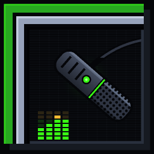
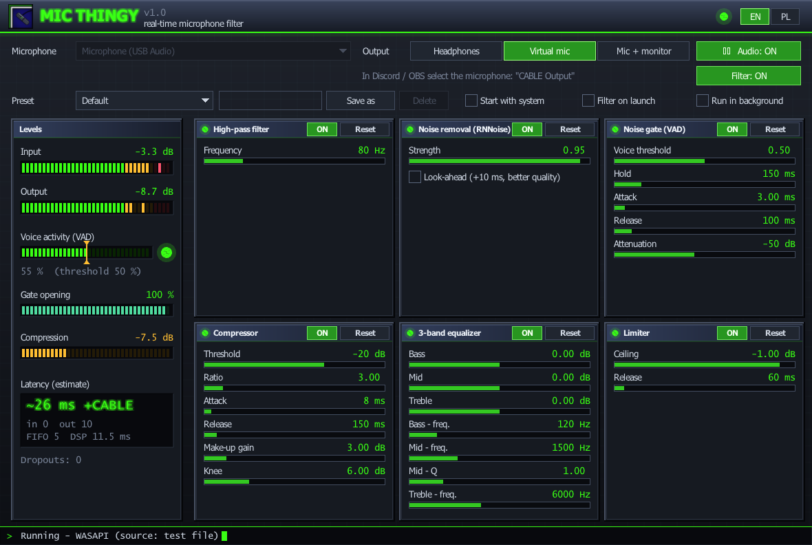

<p align="center"></p>

<h1 align="center">mic thingy</h1>

<p align="center">Real-time microphone filter for Windows 11 and Linux (PipeWire), written in C11.<br>
Noise removal, voice-activated gate, compressor, EQ and limiter, routed to a virtual microphone -
in the spirit of NVIDIA Broadcast / SteelSeries Sonar, but small, open and hackable.</p>

<p align="center"><a href="README.pl.md">Polski</a> · MIT License</p>



## Features

- **Processing chain** (48 kHz, 10 ms frames):
  `mic → high-pass 80 Hz → RNNoise → VAD-driven noise gate → compressor → 3-band EQ → limiter → output`
- **Virtual microphone**: Windows via [VB-Audio Virtual Cable](https://vb-audio.com/Cable/) (apps select "CABLE Output");
  Linux via a native PipeWire source "mic thingy microphone" (no extra software).
- **Monitor**: listen to the processed voice on headphones while it goes to the virtual mic.
- **GUI** (raylib + raygui, early-2000s look): every effect with on/off and sliders, click a value to type an exact
  number, mouse wheel for fine steps, LED meters, voice-activity meter with a draggable gate threshold, latency readout.
- **Presets** (built-in + your own), settings saved automatically, **English / Polish** UI.
- **Runs in the background**: start with the system, tray icon, close-to-tray, single instance, automatic restart
  when an audio device disappears.
- **Optional effects** (off until you switch them on, tabs *Extra* / *Effects*): hum remover (50/60 Hz, auto-detect),
  room-reverb reducer, breath and keyboard-click suppressor, shout guard, auto volume (AGC), de-esser, voice warmth,
  voice effects (pitch, robot, radio), echo cancellation (beta, needs the system-audio loopback).
- **Low-latency mode** (preset "Low latency"): RNNoise only analyses, its gains drive a short minimum-phase filter -
  the filter chain delay drops from 11.5 ms to under 1 ms at the price of rougher noise removal on steady noise.
- **Tools**: own-voice monitor, system-audio mix with ducking (Windows), 8-slot soundboard (drop sound files in),
  A/B test (record, then listen raw vs filtered), recorder (raw + filtered, stereo WAV), calibration wizard,
  quality verdict and dropout history, spectrum analyser.
- **Quality of life**: global mute / push-to-talk / filter hotkeys, mute on screen lock or after silence,
  undo/redo and hold-to-compare, per-microphone settings, presets per running program, preset copy/paste/drop,
  compact always-on-top window, in-game microphone indicator (Windows), three colour themes.
- **Small when hidden**: in the tray the window and its OpenGL context are destroyed - about 1-3 MB of private
  memory with the filter running (the open window needs ~70 MB, mostly the graphics driver).
- **Console version** (`mic-thingy-cli`) with live parameter commands, and offline test tools.
- Real-time safe audio path: no allocation, locks or I/O in the callback; parameters via atomics, meters via a
  lock-free ring buffer.

## Building

Windows (MinGW-w64 GCC, CMake, Ninja):

```
winget install BrechtSanders.WinLibs.POSIX.UCRT Kitware.CMake Ninja-build.Ninja
cmake -S . -B build -G Ninja -DCMAKE_BUILD_TYPE=Release
cmake --build build
ctest --test-dir build
```

Linux (Debian / Ubuntu):

```
sudo apt install build-essential cmake ninja-build pkg-config libpipewire-0.3-dev \
     libx11-dev libxrandr-dev libxinerama-dev libxcursor-dev libxi-dev libgl1-mesa-dev
cmake -S . -B build -G Ninja -DCMAKE_BUILD_TYPE=Release && cmake --build build && ctest --test-dir build
```

Fedora: `gcc cmake ninja-build pkgconf pipewire-devel libX11-devel libXrandr-devel libXinerama-devel libXcursor-devel libXi-devel mesa-libGL-devel`.

CMake options: `-DVF_GUI=OFF` (no GUI), `-DVF_PIPEWIRE=OFF` (Linux without the virtual microphone).
All dependencies are vendored in `third_party/` - no downloads during the build.

> The Linux build (PipeWire source, X11 GUI) has not been tested on real hardware yet - reports welcome.

## Usage

- `build/mic-thingy` - the GUI. Pick your microphone and an output mode, switch **Audio: ON**.
  For the virtual mic select "CABLE Output" (Windows) or "mic thingy microphone" (Linux) in Discord / OBS / Zoom.
  Settings live in `%APPDATA%\mic thingy\settings.ini` or `~/.config/mic-thingy/settings.ini`.
- `build/mic-thingy-cli --help` - console version: `--vmic`, `--monitor N`, `--preset NAME`;
  keys `b` (bypass), `1..6` (toggle effects), `:` for commands such as `set comp ratio 4`.
- Developer tools: `mic-thingy-file` (process a WAV through the chain), `vf-eval` (objective metrics),
  `vf-latency` (round-trip measurement through VB-Cable), `vf-record`, `make_icon` - see [CLAUDE.md](CLAUDE.md).

## Latency

The DSP chain adds about 11.5 ms (RNNoise 10 ms with our look-ahead patch, limiter 1.5 ms).
End to end through WASAPI shared mode and VB-Cable it is typically 50-100 ms; the cable and the
Windows audio buffers dominate. Measurements and the reasoning behind every default are in [CLAUDE.md](CLAUDE.md).

On one test machine a VB-Cable loop measured ~75 ms: ~21 ms for the device buffers on mic thingy's side
and 50-55 ms for the cable plus the Windows audio engine. In real use mic thingy also adds the DSP
(11.5 ms) and its frame buffer (~5 ms), so its whole share is ~37 ms. Things you can do yourself:
- Set the microphone, "CABLE Input" and "CABLE Output" to **48000 Hz** (Sound settings -> device ->
  Advanced). Other rates make Windows resample, which adds delay; the app shows a note when it detects it.
- VB-Cable's own control panel (`VBCABLE_ControlPanel.exe` in its install folder) has a latency /
  buffer setting. A smaller buffer lowers the cable delay but can crackle on a busy system - try a step
  at a time and listen. mic thingy cannot change this setting.
- Measure the effect with `build\vf-latency` (plays short beeps into "CABLE Input" - anything
  listening to "CABLE Output", e.g. Discord, hears them).

## Contributing

Issues and pull requests are welcome - see [CONTRIBUTING.md](CONTRIBUTING.md).

## License

mic thingy is released under the [MIT License](LICENSE).
Bundled libraries (miniaudio, RNNoise, raylib, GLFW, stb, raygui) keep their own permissive licenses -
see [THIRD_PARTY_NOTICES.md](THIRD_PARTY_NOTICES.md).
