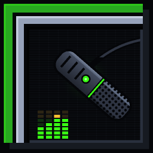

<p align="center"></p>

# mic thingy

[English](README.md) · licencja MIT

Filtr mikrofonu w czasie rzeczywistym (C11, Windows 11 + Linux/PipeWire), w stylu NVIDIA Broadcast / SteelSeries Sonar.

```
mikrofon → high-pass → RNNoise → bramka (VAD) → kompresor → korektor 3-pasmowy → limiter → wyjście
```

Wyjście: słuchawki, **wirtualny mikrofon** (Windows: VB-Cable, w aplikacji wybierasz „CABLE Output”;
Linux: źródło PipeWire „mic thingy microphone”) albo wirtualny mikrofon + odsłuch na słuchawkach.

## Budowanie

Windows (MinGW-w64 GCC, CMake, Ninja — `winget install BrechtSanders.WinLibs.POSIX.UCRT Kitware.CMake Ninja-build.Ninja`):

```
cmake -S . -B build -G Ninja -DCMAKE_BUILD_TYPE=Release
cmake --build build
ctest --test-dir build
```

Linux (Debian/Ubuntu):

```
sudo apt install build-essential cmake ninja-build pkg-config libpipewire-0.3-dev \
     libx11-dev libxrandr-dev libxinerama-dev libxcursor-dev libxi-dev libgl1-mesa-dev
```

Fedora: `gcc cmake ninja-build pkgconf pipewire-devel libX11-devel libXrandr-devel libXinerama-devel libXcursor-devel libXi-devel mesa-libGL-devel`.

Opcje CMake: `-DVF_GUI=OFF` (bez GUI), `-DVF_PIPEWIRE=OFF` (Linux bez wirtualnego mikrofonu).

## Użycie

- `build/mic-thingy` — GUI (domyślnie po angielsku, przełącznik EN/PL w prawym górnym rogu): urządzenia,
  tryb wyjścia, suwaki efektów, wskaźniki, presety, autostart.
  Ustawienia zapisują się same (`%APPDATA%\mic thingy\settings.ini`, `~/.config/mic-thingy/settings.ini`),
  presety użytkownika w podkatalogu `presets/`. Wartość każdego suwaka można kliknąć i wpisać dokładnie (Enter),
  kółko myszy nad suwakiem zmienia ją o 1% (z Shift o 0,1%), a próg głosu można przeciągać na wskaźniku VAD po lewej.
  Ustawienia ze starej wersji (VoiceFilter) przenoszą się same przy pierwszym uruchomieniu.
- **Praca w tle:** zaznacz „Start z systemem” — po zalogowaniu mic thingy uruchomi się schowany w zasobniku
  (ikona z mikrofonem przy zegarze) i od razu zacznie filtrować. Z „Działaj w tle” zamknięcie okna (X) tylko je chowa;
  filtr działa dalej, dopóki nie wybierzesz „Zakończ mic thingy” z menu ikony (prawy przycisk). Kliknięcie ikony
  lub ponowne uruchomienie programu pokazuje okno. Po odłączeniu urządzenia program sam próbuje je ponownie otworzyć.
  Na Linuksie nie ma ikony w zasobniku — okno zamiast tego się minimalizuje.
- `build/mic-thingy-cli` — wersja konsolowa (`--help`): `--vmic`, `--monitor N`, `--preset NAZWA`,
  klawisze `b` (bypass), `1..6` (efekty), `:` (komendy `show`, `set comp ratio 4`, `bypass gate`, `reset`).
- Narzędzia testowe: `mic-thingy-file` (przetwarzanie pliku), `vf-eval` (pomiary), `vf-latency`, `vf-record`
  — opis w `CLAUDE.md`.

## Opóźnienie

Przetwarzanie dodaje ok. 11,5 ms (RNNoise 10 ms + limiter 1,5 ms). Całość z buforami WASAPI i VB-Cable
to zwykle 50–100 ms — cel 20 ms nie jest osiągalny w trybie współdzielonym WASAPI z VB-Cable.
Szczegóły pomiarów: `CLAUDE.md`.

Na komputerze testowym pętla przez VB-Cable trwała ok. 75 ms: ok. 21 ms bufory urządzeń po stronie
mic thingy, 50–55 ms sam kabel i silnik audio Windows. W normalnej pracy mic thingy dokłada jeszcze
filtry (11,5 ms) i bufor ramek (ok. 5 ms), więc cała jego część to ok. 37 ms. Co możesz zrobić sam:
- Ustaw mikrofon, „CABLE Input” i „CABLE Output” na **48000 Hz** (Ustawienia dźwięku → urządzenie →
  Zaawansowane). Inna częstotliwość wymusza przeliczanie próbek i dodaje opóźnienie; program pokazuje
  wtedy komunikat.
- Panel VB-Cable (`VBCABLE_ControlPanel.exe` w folderze instalacji) ma ustawienie opóźnienia / bufora.
  Mniejszy bufor zmniejsza opóźnienie kabla, ale na obciążonym komputerze może trzeszczeć – zmieniaj
  po jednym kroku i słuchaj. mic thingy nie zmieni tego ustawienia za Ciebie.
- Efekt zmierzysz `build\vf-latency` (gra krótkie piski do „CABLE Input” – usłyszy je każda aplikacja
  nasłuchująca „CABLE Output”, np. Discord).

## Licencja

mic thingy jest otwartym oprogramowaniem na licencji [MIT](LICENSE) - można go używać, zmieniać i rozpowszechniać,
zachowując informację o autorach. Dołączone biblioteki (miniaudio, RNNoise, raylib, GLFW, stb, raygui) mają własne,
liberalne licencje - zob. [THIRD_PARTY_NOTICES.md](THIRD_PARTY_NOTICES.md). Jak pomóc: [CONTRIBUTING.md](CONTRIBUTING.md).
